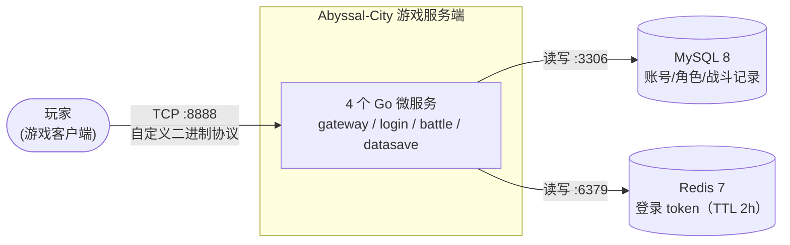
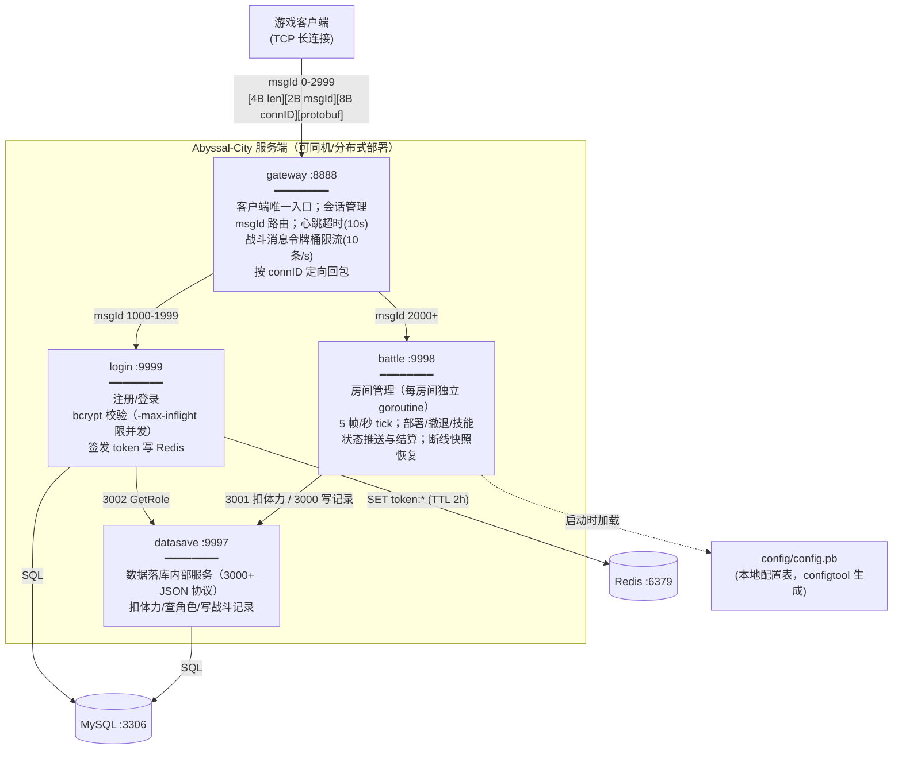
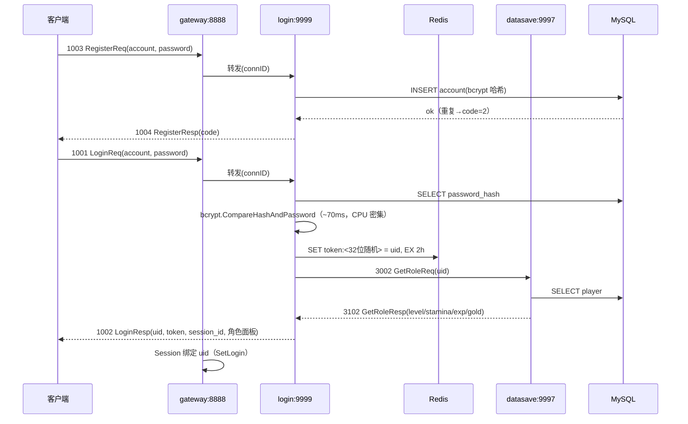
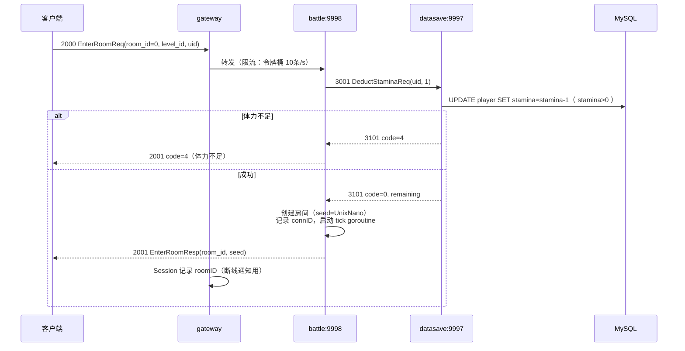
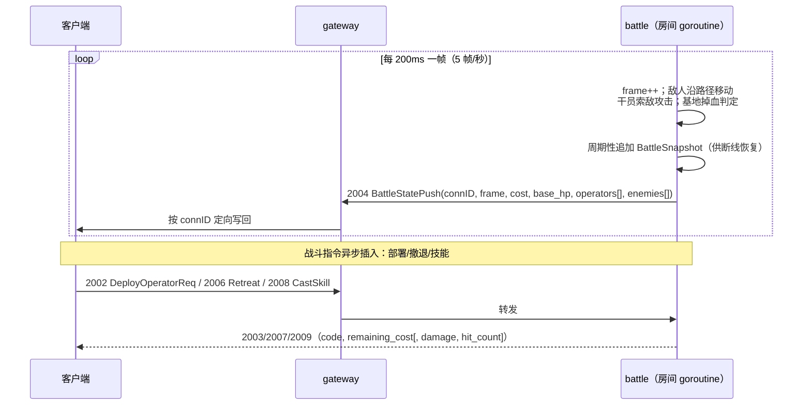
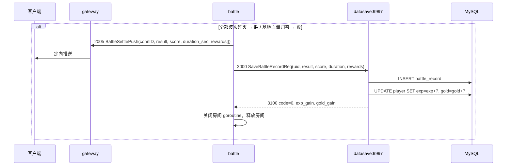
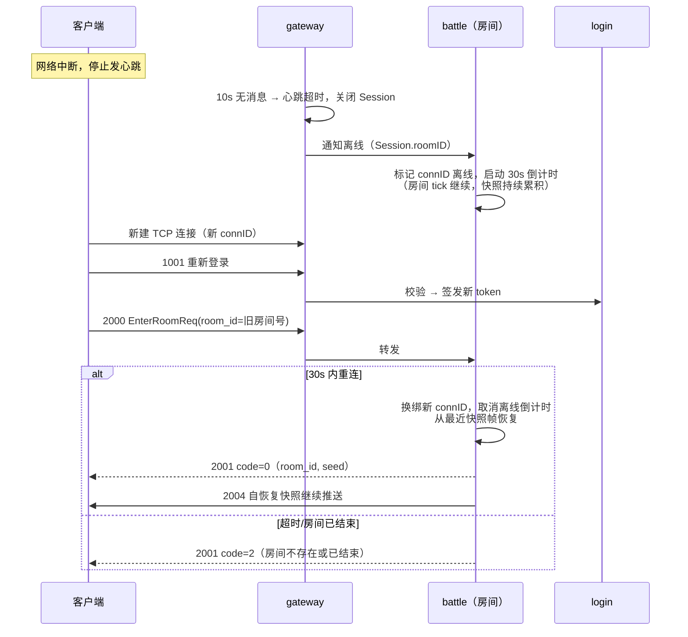

# Abyssal-City 服务端架构说明

分布式塔防游戏服务端：客户端经**网关**单点接入，后端按职责拆成 login / battle / datasave 三个服务，MySQL 持久化、Redis 存会话 token。协议细节见 [protocol.md](protocol.md)，部署见 [deploy.md](deploy.md)，性能数据见 [loadtest-report.md](loadtest-report.md)。

## 1. C4 · 系统上下文图



## 2. C4 · 容器图



## 3. 服务职责表

| 服务 | 端口 | 职责 | 关键设计 |
|---|---|---|---|
| gateway | 8888 | 客户端接入、会话（Session）、路由、限流、心跳超时、connID 定向回包 | 对 login/battle 各一条后端连接，自动重连；所有客户端流量复用 |
| login | 9999 | 注册（bcrypt 哈希入库）、登录校验、签发 token（Redis, 2h）、返回角色面板 | 请求级并发 + `-max-inflight`（默认 8）削峰，防 bcrypt 抢占全机 CPU |
| battle | 9998 | 房间创建/加入、战斗模拟（tick 200ms）、干员部署/撤退/技能、状态推送、结算、断线恢复 | 房间 map + 每房独立 goroutine，全局 RWMutex 仅护 map；断线 30s 内可凭快照续玩 |
| datasave | 9997 | MySQL 唯一出口：扣体力、查角色、写战斗记录并累加 exp/gold | 内部 JSON 协议（3000+）；调用方同步短连接调用 |

## 4. 关键时序图

### ① 注册 / 登录 + token



### ② 进房（扣体力）



### ③ 战斗 tick + 状态推送



### ④ 结算落库



### ⑤ 断线重连



## 5. 目录结构

```
Abyssal-City-server/
├── api/                 # protobuf 定义与生成的 Go 代码
│   ├── base.proto       #   客户端协议（心跳/登录/战斗 0-2999）
│   └── config.proto     #   配置表结构（ConfigSet）
├── cmd/                 # 进程入口
│   ├── gateway/         #   网关
│   ├── battle/          #   战斗服务
│   ├── datasave/        #   数据落库服务
│   └── configtool/      #   配置表工具：xlsx → config.pb
├── config/              # operator.xlsx / level.xlsx / config.pb
├── db/schema.sql        # 建库建表（account / player / battle_record）
├── internal/
│   ├── common/          #   包编解码(packet)、日志(logger)、错误码(预留)
│   ├── config/          #   config.pb 加载查询
│   ├── gateway/         #   server.go(监听/路由/回包) + session.go(会话/限流)
│   ├── login/           #   account.go(注册/登录/token，含 main)
│   ├── battle/          #   server.go(协议分发) + room.go(战斗模拟) + level.go(关卡装配)
│   └── datasave/        #   server.go(3000+ 协议) + db.go + redis.go
├── tmpverify/           # 临时验证工具
│   ├── client/          #   登录链路验证
│   ├── battle/          #   战斗链路验证
│   └── loadtest/        #   压测客户端（见 docs/loadtest-report.md）
├── docs/                # 本文档 / protocol.md / deploy.md / loadtest-report.md
└── docker-compose.yml   # MySQL + Redis（daocloud 镜像源）
```

## 6. 数据流总结

- **读路径**：登录面板（login→datasave 3002→MySQL）。
- **写路径**：进房扣体力、结算写记录（battle→datasave 3001/3000→MySQL）；token（login→Redis）。
- **实时路径**：客户端⇄网关⇄battle 房间 goroutine，200ms 一帧推送；战斗状态全在内存（房间对象 + 周期快照），不落库，只有结算结果落库。
- **解耦点**：MySQL 只有 datasave 一个出口；Redis 只有 login 一个出口；网关对客户端是唯一入口，后端服务均不直接暴露。
